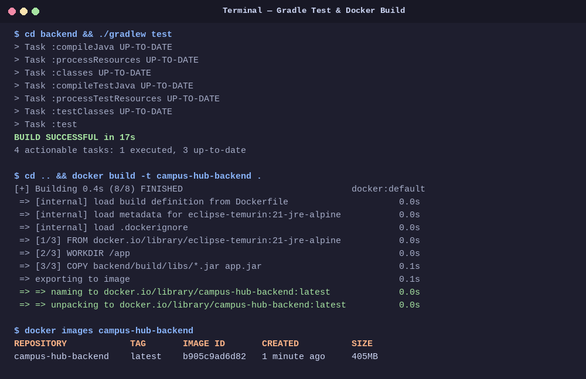
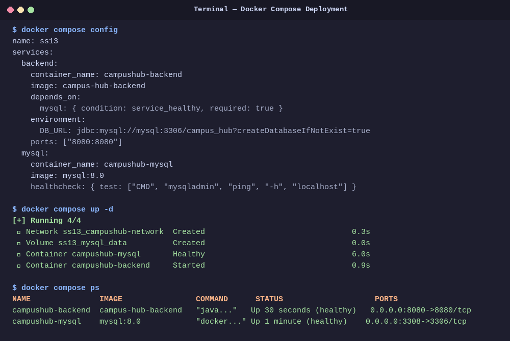
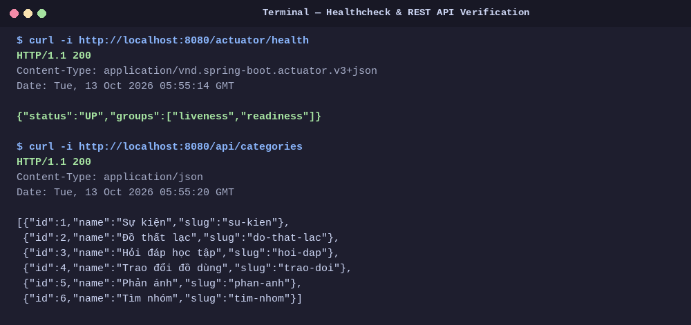

# Bài kiểm tra đầu giờ — Đóng gói và chạy Campus Hub với Docker

> **Môn học:** IT209 - Tích hợp hệ thống  
> **Thời gian:** 45 phút | **Hình thức:** Cá nhân, thực hành trên máy  
> **Dự án:** Campus Hub Base

---

## 1. Thông tin sinh viên

- **Họ và tên:** Nguyễn Việt Trung
- **Mã sinh viên:** `B24DTCN174`
- **Lớp:** CNTT2
- **GitHub:** [vtrung77](https://github.com/vtrung77)
- **VPS Deployment URL:** [http://221.121.3.201:8080](http://221.121.3.201:8080)

---

## 2. Hướng dẫn chạy hệ thống

### 2.1. Kiểm thử Backend bằng Gradle
Chạy unit/integration test của backend Spring Boot:
```bash
cd backend
./gradlew test
```
*Kết quả:* Tất cả kiểm thử chạy thành công (`BUILD SUCCESSFUL`).

### 2.2. Build Docker Image cho Backend
Tạo file executable JAR và đóng gói thành Docker Image:
```bash
# Build JAR với Gradle:
cd backend && ./gradlew bootJar -x test && cd ..

# Đóng gói Docker Image (hỗ trợ cả từ thư mục gốc lẫn thư mục backend):
docker build -t campus-hub-backend .

# Hoặc nếu ở thư mục backend:
cd backend && docker build -t campus-hub-backend .
```
Kiểm tra image trong danh sách Docker:
```bash
docker images campus-hub-backend
```

### 2.3. Khởi chạy hệ thống bằng Docker Compose
Kiểm tra cú pháp cấu hình và khởi chạy các service ở chế độ nền:
```bash
docker compose config
docker compose up -d
```
Xem trạng thái các container:
```bash
docker compose ps
```

---

## 3. Cổng và URL kiểm tra Backend

- **Cổng công khai của Backend:** `8080`
- **URL Healthcheck:** [http://localhost:8080/actuator/health](http://localhost:8080/actuator/health)
  - Trả về mã HTTP `200 OK` và JSON: `{"status":"UP","groups":["liveness","readiness"]}`
- **URL API kiểm tra dữ liệu kết nối MySQL:** [http://localhost:8080/api/categories](http://localhost:8080/api/categories)
  - Trả về danh sách chuyên mục đã được Flyway & Data Seeder khởi tạo vào database `campus_hub`.
- **Cổng công khai MySQL:** `3308` (ánh xạ từ cổng nội bộ `3306` của container để tránh xung đột cổng với máy host).

Lệnh kiểm tra nhanh:
```bash
# Kiểm tra Health endpoint:
curl -i http://localhost:8080/actuator/health

# Kiểm tra API dữ liệu từ MySQL:
curl -i http://localhost:8080/api/categories
```

---

## 4. Minh chứng kết quả thực hiện

### 4.1. Minh chứng 1 — Kiểm thử Gradle & Build Docker Image thành công
Gradle test thực thi thành công (`BUILD SUCCESSFUL`), Docker Image `campus-hub-backend:latest` được đóng gói thành công và xuất hiện trong danh sách `docker images`.



---

### 4.2. Minh chứng 2 — Docker Compose hợp lệ & các Service hoạt động ổn định
Cấu hình Compose hợp lệ (`docker compose config`), hai service `campushub-backend` và `campushub-mysql` cùng khởi động, kết nối mạng nội bộ (`campushub-network`), volume lưu trữ MySQL (`mysql_data`), và cả hai đều duy trì trạng thái **healthy**.



---

### 4.3. Minh chứng 3 — Phản hồi Actuator Health (HTTP 200 UP) & MySQL Data
Endpoint `/actuator/health` trả về mã trạng thái **HTTP 200 OK** với `{"status":"UP"}`. Backend kết nối thành công tới MySQL qua tên service `mysql` và lấy dữ liệu chuyên mục từ database (`/api/categories`).



---

# Tài liệu gốc dự án Campus Hub Base

Campus Hub là dự án nền cho Mini Project Session 13. Ứng dụng cung cấp một không gian chung để sinh viên đăng sự kiện, tìm đồ thất lạc, hỏi đáp, trao đổi đồ dùng và tìm nhóm.

Dự án được giữ ở mức nhỏ để dễ đọc và sửa đổi, nhưng đã có đủ luồng giao diện, API, xác thực, migration và kiểm thử.

## Chức năng có sẵn

- Xem, tìm kiếm và lọc bài đăng.
- Đăng ký, đăng nhập bằng HTTP Basic.
- Tạo bài đăng theo chuyên mục.
- Bình luận và bày tỏ quan tâm.
- Chủ bài đăng có thể đánh dấu bài đã hoàn tất.
- Quản trị viên có quyền quản lý trạng thái bài đăng qua API.
- Health check tại `/actuator/health`.

Tài khoản mẫu được tạo khi ứng dụng khởi động lần đầu:

| Vai trò | Tên đăng nhập | Mật khẩu |
|---|---|---|
| Sinh viên | `student` | `student123` |
| Quản trị viên | `admin` | `admin123` |

## Kiến trúc

```text
React frontend
    │ /api
    ▼
Spring Boot monolith
    │ JDBC
    ▼
MySQL
```

Backend gồm năm bảng chính: `users`, `categories`, `posts`, `comments` và `reactions`. Frontend không sử dụng thư viện giao diện hay thư viện quản lý trạng thái để sinh viên dễ đọc mã nguồn.

## API chính

| Phương thức | Đường dẫn | Mục đích | Xác thực |
|---|---|---|---|
| `POST` | `/api/auth/register` | Tạo tài khoản | Không |
| `GET` | `/api/auth/me` | Lấy người dùng hiện tại | Có |
| `GET` | `/api/categories` | Danh sách chuyên mục | Không |
| `GET` | `/api/posts` | Tìm và lọc bài đăng | Không |
| `GET` | `/api/posts/{id}` | Chi tiết bài đăng | Không |
| `POST` | `/api/posts` | Tạo bài đăng | Có |
| `PUT` | `/api/posts/{id}` | Sửa bài của mình | Có |
| `PATCH` | `/api/posts/{id}/status` | Đổi trạng thái | Có |
| `DELETE` | `/api/posts/{id}` | Xóa bài của mình | Có |
| `POST` | `/api/posts/{id}/comments` | Thêm bình luận | Có |
| `POST` | `/api/posts/{id}/reaction` | Bật hoặc tắt quan tâm | Có |
